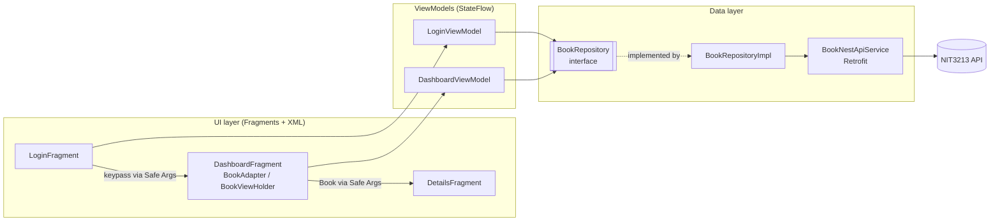
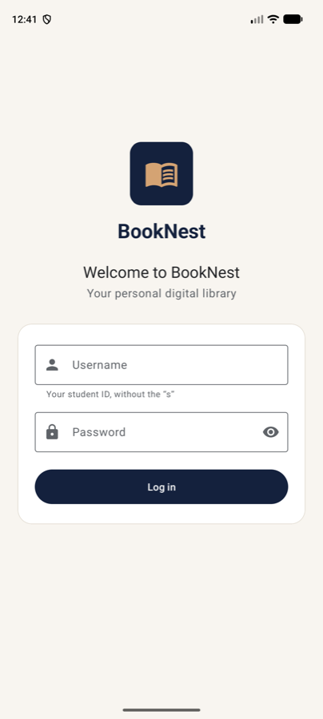
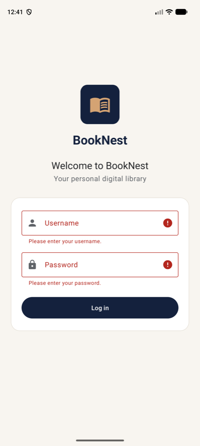
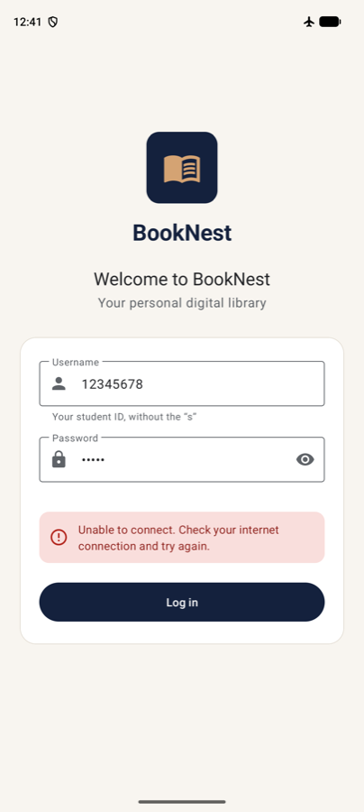
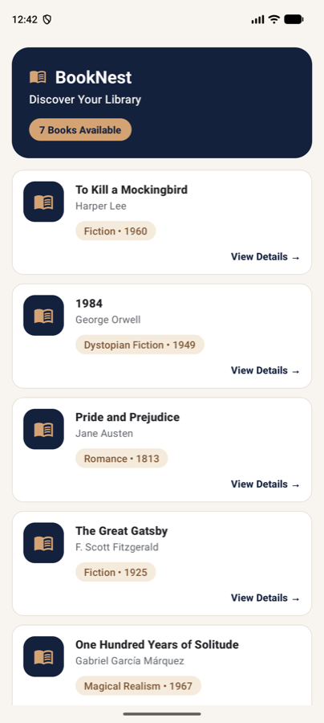
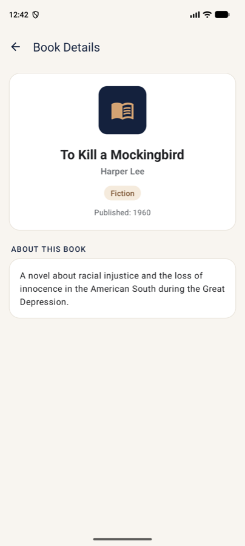
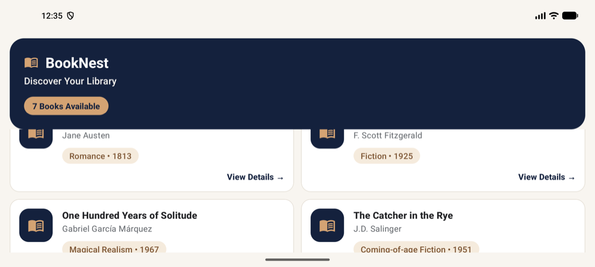

# BookNest

**NIT3213 Android Application Development — Final Assignment**
Android Studio project: `8160071Assignment2` · Package: `com.example.booknest`

BookNest is a digital library app for Android. A student logs in with their university credentials, browses every book returned by the NIT3213 API, and opens any book to read its full details.

---

## Contents

1. [Project Overview](#1-project-overview)
2. [Features](#2-features)
3. [Technology Stack](#3-technology-stack)
4. [Architecture](#4-architecture)
5. [Dependency Injection with Hilt](#5-dependency-injection-with-hilt)
6. [API Integration](#6-api-integration)
7. [Installation](#7-installation)
8. [Building the App](#8-building-the-app)
9. [Running the App](#9-running-the-app)
10. [Unit Tests](#10-unit-tests)
11. [Screenshots](#11-screenshots)
12. [Known Limitations](#12-known-limitations)

---

## 1. Project Overview

The app has three screens, connected with the Android Navigation Component:

| Screen | Purpose |
|---|---|
| **Login** | Authenticates the user against `POST /sydney/auth` and receives a *keypass*. |
| **Dashboard** | Uses the keypass to call `GET /dashboard/{keypass}` and lists every book in a `RecyclerView`. Each card shows a summary (title, author, genre, year) without the description. |
| **Book Details** | Shows all five properties of the selected book, including the full description. |

The project uses Kotlin, XML layouts (Android Views, no Jetpack Compose), MVVM, Hilt for dependency injection, Retrofit with coroutines for networking, and JUnit/MockK for unit testing.

## 2. Features

**Login**
- Material outlined text fields; the password is hidden and has a show/hide toggle.
- Input validation: a clear message appears under an empty username or password field, and no request is sent.
- A progress indicator is shown and the form is disabled while signing in, so only one request can be in flight.
- Friendly messages for wrong credentials, no connection, timeouts, server errors and unexpected responses.
- Credentials are never hard-coded or pre-filled; the keypass from the server is used exactly as returned.

**Dashboard**
- Header with the app name, "Discover Your Library" and a live count, e.g. *7 Books Available*.
- Every book returned by the API, in Material cards inside a `RecyclerView`: title, author, genre and publication year (no description).
- 1 column on phones and 2 columns on wide screens (tablets and landscape).
- Loading, error (with a **Try again** button) and empty states.
- Books are loaded once; rotating the screen or returning from Details does not trigger another request.

**Book Details**
- Title, author, genre, publication year and full description in a scrollable layout.
- The selected book is passed as a navigation argument, so no extra network call is made.
- Up arrow in the toolbar and the system Back button both return to the library.

**Design and accessibility**
- "Premium digital library" theme: deep navy `#14213D`, warm gold `#D4A373`, soft cream `#F8F5F0`, white cards, charcoal text `#202124`. Text colour pairs meet WCAG AA contrast.
- All text sizes in `sp` via Material type styles; touch targets of at least 48 dp.
- Screen-reader support: headings are marked, decorative images are hidden, each book card reads as one sentence ("The Hobbit by J.R.R. Tolkien. Fantasy, 1937."), and errors and the book count are announced through live regions.
- Edge-to-edge layout that keeps content clear of the status bar, navigation bar and keyboard.

## 3. Technology Stack

| Area | Library / Tool | Version |
|---|---|---|
| Language | Kotlin (AGP built-in Kotlin) | 2.3.21 |
| Build | Android Gradle Plugin / Gradle (Kotlin DSL, version catalog) | 9.4.1 / 9.6.0 |
| SDK | compileSdk / targetSdk / minSdk | 37 / 37 / 24 |
| UI | XML layouts, Material Components, ConstraintLayout, RecyclerView | Material 1.14.0, RecyclerView 1.4.0 |
| Architecture | AndroidX ViewModel, StateFlow, `repeatOnLifecycle` | Lifecycle 2.11.0 |
| Navigation | Navigation Component + Safe Args, Kotlin Parcelize | 2.10.2 |
| Dependency injection | Hilt (code generation via KSP) | Hilt 2.60.1, KSP 2.3.12 |
| Networking | Retrofit + Moshi converter, OkHttp logging interceptor | Retrofit 3.0.0, Moshi 1.15.2, OkHttp 4.12.0 |
| Async | Kotlin Coroutines | 1.11.0 |
| Testing | JUnit 4, MockK, kotlinx-coroutines-test | 4.13.2, 1.14.11, 1.11.0 |
| Version control | Git and GitHub | — |

All versions are declared once in [`gradle/libs.versions.toml`](gradle/libs.versions.toml).

## 4. Architecture

BookNest follows **MVVM** with a repository layer. Each layer has one responsibility, and dependencies point only one way: UI → ViewModel → Repository → API.



- **Fragments** only find their views (`findViewById`), forward user actions to the ViewModel and render the state they receive. They contain no networking or validation logic.
- **ViewModels** hold screen state in a private `MutableStateFlow` exposed as a read-only `StateFlow`, and run work in `viewModelScope`. The Fragments collect that state with `viewLifecycleOwner.repeatOnLifecycle(Lifecycle.State.STARTED)`, so collection stops while the screen is in the background.
- **Repository**: the ViewModels depend on the `BookRepository` *interface* (dependency inversion). `BookRepositoryImpl` calls Retrofit and converts every outcome (success, HTTP error, empty body, malformed JSON, timeout, no connection) into a `Resource` (`Loading` / `Success` / `Error(AppError)`). The data layer never throws to the UI and contains no user-facing text.
- **Error messages**: `AppError` describes *what* went wrong, and `ui/ErrorMessages.kt` maps it to a message in `strings.xml`. Raw exceptions are never shown to the user.

### Project structure

```
app/src/main/java/com/example/booknest/
├── BookNestApplication.kt          @HiltAndroidApp application class
├── data/
│   ├── model/                      Book, LoginRequest, LoginResponse, DashboardResponse
│   ├── remote/BookNestApiService.kt   Retrofit endpoints (suspend functions)
│   └── repository/                 BookRepository (interface) + BookRepositoryImpl
├── di/
│   ├── NetworkModule.kt            Provides Moshi, OkHttpClient, Retrofit, API service
│   └── RepositoryModule.kt         Binds BookRepository to BookRepositoryImpl
├── ui/
│   ├── MainActivity.kt             Single activity hosting the NavHostFragment
│   ├── ErrorMessages.kt            AppError -> string resource
│   ├── login/                      LoginFragment, LoginViewModel, LoginUiState
│   ├── dashboard/                  DashboardFragment, DashboardViewModel, BookAdapter, BookViewHolder
│   └── details/DetailsFragment.kt
└── util/                           Resource, AppError

app/src/main/res/
├── layout/                         activity_main, fragment_login, fragment_dashboard, item_book, fragment_details
├── navigation/nav_graph.xml        Destinations, actions and Safe Args arguments
└── values/                         strings, colors, themes, integers (+ values-w600dp for 2 columns)
```

### Navigation

`nav_graph.xml` defines three destinations:
- **Login → Dashboard** passes the `keypass` (String). The action pops Login off the back stack, so Back on the Dashboard leaves the app instead of reopening the login form.
- **Dashboard → Details** passes the selected `Book`, which is `@Parcelize`.

`DashboardViewModel` reads the keypass from its `SavedStateHandle`, which Navigation fills from the destination's arguments. `DetailsFragment` reads the book with `by navArgs()`.

## 5. Dependency Injection with Hilt

Hilt builds the dependency graph at compile time. No class creates its own Retrofit client or repository:

```
Moshi ─┐
       ├─► Retrofit ─► BookNestApiService ─► BookRepositoryImpl ─► BookRepository ─► LoginViewModel / DashboardViewModel ─► Fragments
OkHttp ┘   (NetworkModule, @Singleton)        (@Inject constructor)  (RepositoryModule)   (@HiltViewModel)                    (@AndroidEntryPoint)
```

| Annotation | Where | What it does |
|---|---|---|
| `@HiltAndroidApp` | `BookNestApplication` | Starts Hilt's code generation and creates the application-level container (`SingletonComponent`) at the root of the graph. |
| `@AndroidEntryPoint` | `MainActivity`, `LoginFragment`, `DashboardFragment` | Lets Hilt inject into these Android classes. Fragments need it to get Hilt ViewModels, and a Hilt Fragment's Activity must be annotated too. |
| `@HiltViewModel` | `LoginViewModel`, `DashboardViewModel` | Lets Hilt create the ViewModel (through `by viewModels()`) and supply its constructor dependencies, including `SavedStateHandle`. |
| `@Inject` | ViewModel and `BookRepositoryImpl` constructors | Constructor injection: tells Hilt how to build the class and which dependencies it needs. |
| `@Module` | `NetworkModule`, `RepositoryModule` | Holds instructions for types Hilt can't construct itself: third-party classes (Retrofit, OkHttp, Moshi) and interfaces (`BookRepository`). |
| `@InstallIn(SingletonComponent::class)` | Both modules | Makes the bindings available app-wide, for the lifetime of the application. |
| `@Provides` | Module functions | Each function tells Hilt how to create one dependency; its parameters are injected too. |
| `@Singleton` | Moshi, OkHttpClient, Retrofit, API service, repository | One shared instance for the whole app (one connection pool, one configuration). |

`DetailsFragment` injects nothing, so it isn't an `@AndroidEntryPoint`.

`RepositoryModule` binds the interface with `@Provides fun provideBookRepository(impl: BookRepositoryImpl): BookRepository = impl`, following the lecture's `@Provides` approach. A `@Binds` abstract function would do the same job.

**Why dependency injection helps**
- **Testability:** ViewModels receive a `BookRepository`, so the tests pass in a MockK mock instead and never touch the network.
- **Maintainability:** networking is configured in one place (`NetworkModule`). Changing the base URL, timeouts or logging doesn't touch any screen.
- **Modularity / loose coupling:** classes depend on abstractions, not concrete implementations. `BookRepositoryImpl` could be replaced (for example by a cached version) by changing a single binding.
- **Lifecycle management:** Hilt creates singletons once and scopes ViewModels to their screen, so there's no hand-written factory code.

> **KSP instead of kapt.** Lecture 7 sets Hilt up with `kapt`. This project uses AGP 9's built-in Kotlin support, which does not support the `kotlin-kapt` plugin, so Hilt and Moshi generate their code with **KSP** (Google's recommended replacement). The Hilt annotations and how they're used are unchanged; only the `ksp(...)` dependency lines in `app/build.gradle.kts` differ.

## 6. API Integration

Base URL: `https://nit3213apinew.onrender.com/` (stored once as `BuildConfig.BASE_URL` in `app/build.gradle.kts`).

### Endpoints

| Call | Method & path | Request | Successful response |
|---|---|---|---|
| Login | `POST /sydney/auth` | `{"username": "<student ID>", "password": "<first name>"}` | `200 {"keypass": "<topic>"}` |
| Dashboard | `GET /dashboard/{keypass}` | — | `200 {"entities": [ … ], "entityTotal": n}` |

Each entity is mapped to:

```kotlin
data class Book(val title: String, val author: String, val genre: String,
                val publicationYear: Int, val description: String)
```

### How the API is used

1. The user submits the form. `LoginViewModel` validates it and calls `repository.login()` in `viewModelScope`.
2. Retrofit sends the `LoginRequest` as JSON using the `suspend fun login()` in `BookNestApiService`. OkHttp runs the request on a background thread, so the main thread is never blocked.
3. The returned keypass is passed to the Dashboard. It is never assumed to be `"books"`.
4. `DashboardViewModel` calls `repository.getBooks(keypass)`, and Moshi converts the JSON into `DashboardResponse` / `List<Book>`.
5. All books in the response are shown, so the list works for any number of books, not only seven.

### Error handling

| Situation | Detected as | Message shown |
|---|---|---|
| Wrong password (`400`) or unknown username (`404`) on login | HTTP 4xx | "Incorrect username or password. Please try again." |
| Unknown keypass on the dashboard (`404`) | HTTP 4xx | "We couldn't open your library…" |
| Server failure | HTTP 5xx | "The library server is having problems…" |
| No internet / DNS failure | `IOException` | "Unable to connect. Check your internet connection…" |
| Slow server | `SocketTimeoutException` | "The server is taking too long to respond. It may be starting up…" |
| Empty body, blank keypass, invalid or mismatched JSON | `null` body, `JsonEncodingException`, `JsonDataException` | "We received an unexpected response from the server…" |
| Anything else | `Exception` | "Something went wrong. Please try again." |

Coroutine cancellation (for example, the user leaving the screen mid-request) is rethrown rather than reported as an error.

Network logging is set to `BASIC` (method, URL, status code, timing) in debug builds and turned off in release. `BODY` logging is deliberately not used because it would write the password to Logcat.

## 7. Installation

**Requirements**
- Android Studio with Android Gradle Plugin 9.4 support (developed with Android Studio 2026.1).
- Android SDK Platform 37 (Android Studio offers to install it on first sync).
- JDK: the Gradle daemon is pinned to Java 25 in `gradle/gradle-daemon-jvm.properties`. Gradle downloads a matching JDK automatically if one isn't installed.
- An emulator or device running Android 7.0 (API 24) or newer, with internet access.

**Get the code**

```bash
git clone https://github.com/Obsidianblade/8160071Assignment2.git
cd 8160071Assignment2
```

Then in Android Studio choose **File → Open**, select the `8160071Assignment2` folder and wait for the Gradle sync to finish. Android Studio creates `local.properties` (your SDK path) automatically; it is machine-specific and deliberately not committed.

## 8. Building the App

**Android Studio:** **Build → Assemble Project** (or press ⌘F9 / Ctrl+F9).

**Command line** (from the project root):

```bash
./gradlew assembleDebug        # builds app/build/outputs/apk/debug/app-debug.apk
./gradlew lintDebug            # optional: Android Lint report in app/build/reports/
```

On Windows, use `gradlew.bat` instead of `./gradlew`.

## 9. Running the App

1. Start an emulator (**Device Manager**) or connect a device with USB debugging enabled.
2. Select the **app** run configuration and press **Run ▶** (Shift+F10).
3. Log in:
   - **Username:** your student ID *without* the leading "s" (for example `12345678`).
   - **Password:** your first name. It is case-sensitive.
4. Tap any book on the dashboard to open its details. Use the up arrow or Back to return.

The API host sleeps when idle, so the **first** login after a quiet period can take about a minute while the server wakes up; the app keeps showing *Signing in…* and waits up to two minutes. If the timeout message still appears, tap **Log in** or **Try again** once more. To wake the server in advance, open <https://nit3213apinew.onrender.com/dashboard/books> in a browser.

You can also install from the command line with `./gradlew installDebug`.

## 10. Unit Tests

Unit tests live in `app/src/test/` and run on the JVM. They need no emulator and make **no real network requests**: the repository and API service are replaced with MockK mocks or fixed JSON, and the credentials in the tests are fake.

| Test class | What it verifies |
|---|---|
| `LoginViewModelTest` (12) | Successful login exposes the keypass; the keypass is used as returned; invalid credentials and network failures produce the right error; an empty username or password shows a validation error **without** calling the API; the loading state is shown and then cleared; a second tap while loading doesn't send a duplicate request; the username is trimmed but the password isn't; field errors clear on typing; navigation happens only once. |
| `DashboardViewModelTest` (8) | Starts in `Loading`, then `Success` with all books in API order; uses the keypass from the navigation arguments; an empty list is handled; a server error is exposed; a missing keypass is reported without an API call; retry goes back to `Loading` and recovers; no duplicate requests while loading. |
| `BookRepositoryImplTest` (16) | The request body sent to the API; HTTP 400/404 → invalid credentials; 404 on the dashboard → invalid keypass; 500/503 → server error; empty body and blank keypass → unexpected response; `IOException` → network; timeout; malformed and mismatched JSON; unknown exceptions; cancellation is rethrown. |
| `JsonParsingTest` (4) | The Moshi adapters parse the real API JSON (including accented names), serialise the login request with the expected field names, and reject a book with a missing field. |
| `BookAdapterTest` (3) | Item count before and after `setData`, list replacement, and that `notifyDataSetChanged()` is called, using a MockK `spyk` as in Lecture 8. |

**How the tests work**
- `MainDispatcherRule` replaces `Dispatchers.Main` with a `StandardTestDispatcher` before each test and resets it afterwards (`Dispatchers.setMain` / `resetMain` from Lecture 8). That lets `viewModelScope` run on the JVM.
- Tests use `runTest`. Because `StandardTestDispatcher` queues coroutines, a test can check the `Loading` state first and then call `advanceUntilIdle()` to let the work finish. `delay()` inside mocks uses virtual time, so the tests are fast and deterministic.
- `coEvery { … } returns …` stubs suspend functions; `coVerify(exactly = n) { … }` checks how many times the API or repository was called.
- Tests follow a *Given / When / Then* structure.

**Running the tests**
- **Android Studio:** in the Project panel, right-click `app/src/test/java/com/example/booknest` and choose **Run 'Tests in booknest'**. To run a single class or test, click the green ▶ next to its name.
- **Command line:**
  ```bash
  ./gradlew testDebugUnitTest
  ```
  The HTML report is written to `app/build/reports/tests/testDebugUnitTest/index.html`.

Current result: **43 tests, 0 failures.**

## 11. Screenshots

| Login | Validation | Offline error |
|---|---|---|
|  |  |  |

| Dashboard | Book Details |
|---|---|
|  |  |

**Dashboard in landscape (2-column grid)**



The screenshots don't show real login details; the offline-error screenshot uses dummy values.

## 12. Known Limitations

- **Book-specific data model.** The `Book` class matches the topic returned for this student's keypass (`books`). If the server returned a different topic with different fields, the app would show its "unexpected response" message instead of the data.
- **Sydney campus only.** The login endpoint is fixed to `/sydney/auth`.
- **No saved session.** The keypass isn't stored, so the user logs in again each time the app starts. There is also no logout button; Back on the Dashboard closes the app.
- **No offline cache.** The book list needs a network connection.
- **Cold starts.** The API host sleeps when idle, so the first request can take about a minute. The app waits up to two minutes (read timeout in `NetworkModule`); if the server takes longer, it shows a timeout message and the user retries.
- **Light theme only.** The brand palette is designed for a light background, so the app doesn't switch to a dark theme.
- **Launcher icon on Android 7.x.** The branded adaptive icon needs API 26+; devices on API 24–25 show the default bitmap icon.
- **Tests.** Only unit tests are included (as specified in Lecture 8); there are no instrumented or UI tests.
